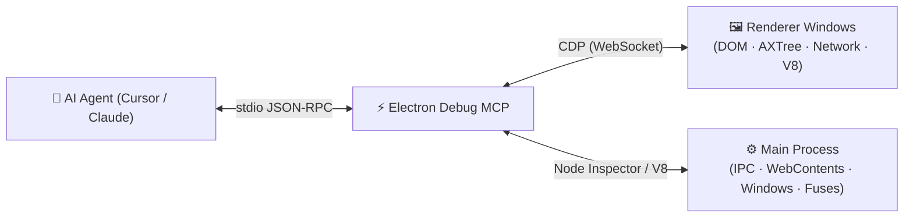

<div align="center">


# Electron Debug MCP

**Real Chrome DevTools Protocol superpowers for AI coding agents.**<br/>
*Give Cursor, Claude & autonomous agents eyes, hands, and deep runtime inspection inside Electron desktop applications.*

<p align="center">
  
  
  
  
  
  
  
</p>

<p align="center">
  <a href="#-quick-start"><b>Quick Start</b></a> •
  <a href="#-key-superpowers"><b>Superpowers</b></a> •
  <a href="#-tool-matrix-96-tools"><b>Tool Matrix</b></a> •
  <a href="#-agent-recipes"><b>Recipes</b></a> •
  <a href="#-resources--prompts"><b>Resources & Prompts</b></a> •
  <a href="#-troubleshooting"><b>Troubleshooting</b></a>
</p>

---

</div>

## 🌟 Why Electron Debug MCP?

Most AI coding agents struggle with desktop applications: they can edit source code, but they cannot **see** the resulting window, **click** buttons, **read** console errors, or **diagnose** silent main-process crashes.

**Electron Debug MCP** bridges your agent directly into your Electron runtime via the **Chrome DevTools Protocol (CDP)** and **Node inspector**, unlocking full visual, interactive, and diagnostic autonomy.



---

## ✨ Key Superpowers

<table>
<tr>
<td width="50%">

### 🛡️ Runtime Security Audit
`electron_security_audit` evaluates running windows against official Electron security guidelines. Flags `nodeIntegration`, missing `contextIsolation`, disabled sandbox, unsafe CSP, missing `setWindowOpenHandler`, unguarded `will-navigate`, and executable binary fuses.

</td>
<td width="50%">

### 🔒 Zero-Leak Secret Automation
Automate logins and API forms without leaking credentials. `type_text({ text: "{{secret:VAR}}" })` resolves from `process.env` and automatically redacts the secret from return values, console logs, network entries, and HAR exports with `[REDACTED]`.

</td>
</tr>
<tr>
<td width="50%">

### 🧩 Autonomous Composite Workflows
High-level single-turn workflows reduce round trips:
- **`act_and_verify`**: Action → network idle → UI assertion → automatic failure screenshot if assertion fails.
- **`triage`**: Instant health overview with page state, console errors, network failures, and resolved top exception stack.
- **`network_failure_report`**: Aggregates failed HTTP calls with response bodies inline plus an exported HAR artifact.

</td>
<td width="50%">

### 🔌 Deep IPC Observability
- **`ipc_tap`**: Intercepts main-process `ipcMain.handle` and `webContents.send` calls.
- **`ipc_invoke`**: Call any registered main-process handle channel directly with custom arguments.
- **`ipc_schema_inference`**: Analyzes traffic patterns and automatically emits inferred TypeScript interfaces for your preload bridge.

</td>
</tr>
<tr>
<td width="50%">

### 🗺️ Source-Mapped Stack Traces
`resolve_stack` decodes inline base64 and external v3 source maps. When your bundled app throws an exception, the agent gets original `.ts` and `.tsx` file names, line numbers, and original source snippets rather than minified bundle noise.

</td>
<td width="50%">

### ⚡ Frictionless Agent Ergonomics
- **Optional `processId`**: Automatically defaults to the single active app session.
- **Tool Annotations**: Tools declare standard MCP hints (`readOnlyHint`, `destructiveHint`) so clients can auto-approve safe queries.
- **Artifacts Resource**: Output files are indexed as `electron://artifact/{id}`.

</td>
</tr>
</table>

---

## ⚡ Quick Start

### 1. Configure Your MCP Client

#### 🚀 In Cursor (`~/.cursor/mcp.json` or `.cursor/mcp.json`)
```json
{
  "mcpServers": {
    "electron-debug": {
      "command": "npx",
      "args": ["-y", "electron-debug-mcp@latest"]
    }
  }
}
```

#### 💬 In Claude Desktop (`claude_desktop_config.json`)
```json
{
  "mcpServers": {
    "electron-debug": {
      "command": "npx",
      "args": ["-y", "electron-debug-mcp@latest"]
    }
  }
}
```

> [!TIP]
> **Developing locally?** Run `npm run build` and configure `"command": "node"` with `"args": ["/path/to/electron-mcp-server/build/index.js"]`.

---

## 🛠️ Tool Matrix (106 Tools)

All tools accept an optional `processId`. When only one app is running, it automatically resolves to the active process.

### 🚀 Lifecycle & Connection (8)
| Tool | Description |
| --- | --- |
| `start_app` | Launch Electron app with remote debugging port. Set `inspectMain: true` to enable main-process debugging. |
| `stop_app` | Terminate launched app or detach from an attached session. |
| `attach` | Connect to a running Electron app via DevTools port or WebSocket URL. |
| `attach_by_pid` | Detect DevTools port from an Electron OS PID's command line and attach. |
| `find_apps` | Enumerate all running Electron processes on the host machine. |
| `discover_apps` | Scan local TCP ports (default 9222–9322) to discover live CDP debug endpoints. |
| `find_installed_apps` | Scan standard OS application directories for installed packaged Electron apps. |
| `list_apps` | Enumerate all active and managed sessions with uptime, PID, and target counts. |

### 👁️ See & Visual Inspection (8)
| Tool | Description |
| --- | --- |
| `vision` | Recommended one-shot snapshot: viewport screenshot, page URL/title, console errors, and network failures. Supports `markElements: true` for Set-of-Marks visual badges. |
| `snapshot` | Complete semantic accessibility tree (`Accessibility.getFullAXTree`) with stable element refs (`ref: "e1"`), roles, names, and backend IDs. Supports `markElements: true`. |
| `screenshot` | Capture viewport PNG or JPEG base64 payload. |
| `save_screenshot` | Capture screenshot to disk (supports CSS selector clipping); registers an artifact. |
| `diff_screenshot` | Visual regression comparison against a baseline screenshot. |
| `start_screencast` | Stream live viewport frames into a bounded ring buffer. |
| `stop_screencast` | Stop screencasting and optionally save the final frame to disk. |
| `highlight` | Visually highlight a DOM element in the viewport with border and background overlays. |

### 🖱️ Act & UI Automation (13)
| Tool | Description |
| --- | --- |
| `act_and_verify` | **Composite:** Executes an action (`click`, `type`, `click_ax`), waits for network idle, verifies assertion, and captures failure screenshot if failed. |
| `click` | Click the center of an element matching a CSS `selector` or accessibility `ref` (e.g. `"e1"`). |
| `click_ax` | Robust click locating an element by its accessibility name and optional role. |
| `type_text` | Type text into focused element, `selector`, or `ref`. Supports `{{secret:VAR}}` resolution and redaction. |
| `type_ax` | Focus an element by accessibility name and type text with secret placeholder support. |
| `press_key` | Dispatch keypress or keyboard shortcut (Enter, Escape, Tab, Arrows, Ctrl+A, etc.). |
| `hover` | Move mouse pointer over a CSS `selector` or `ref` without clicking. |
| `scroll` | Scroll page or element by delta coordinates, or scroll a `selector` or `ref` into view. |
| `drag` | Drag-and-drop between two selectors or refs with native HTML5 `dataTransfer` payload. |
| `select_option` | Select an option in a `<select>` dropdown by value or label. |
| `set_file_input` | Programmatically set files on an `<input type="file">`. |
| `handle_dialog` | Automatically accept or dismiss JavaScript alerts, confirms, and prompts. |
| `open_deep_link` | Dispatch a custom protocol deep link (e.g. `myapp://action`) into the application. |

### 📄 Page State & Navigation (17)
| Tool | Description |
| --- | --- |
| `page_info` | Basic page details: URL, title, dimensions, readyState, and user agent. |
| `navigate` | Navigate the active page target to a URL with configurable load-state waiting. |
| `reload` | Reload the active page target (supports cache busting). |
| `wait_for` | Wait for a CSS selector, page title, URL substring, or custom JS expression. |
| `get_dom` | Retrieve page HTML markup (supports CSS selector root and `maxLength` token protection). |
| `query_selector` | Evaluate CSS query and inspect matching elements' attributes and text content. |
| `evaluate` | Evaluate arbitrary JavaScript in the renderer page context. |
| `get_console_messages` | Retrieve buffered console messages and exceptions (supports level and tail filtering). |
| `get_logs` | Retrieve captured process stdout and stderr logs. |
| `get_cookies` | Inspect cookies for specified URLs or across all targets. |
| `set_cookie` | Set browser cookies with domain, path, and security flags. |
| `delete_cookie` | Delete a specific cookie by name. |
| `get_storage` | Read items from `localStorage` or `sessionStorage`. |
| `set_storage` | Write items to `localStorage` or `sessionStorage`. |
| `assert_ui` | Verify page URL, title, element visibility, text matches, and absence of console errors. |
| `save_storage_state` | Export cookies, `localStorage`, and `sessionStorage` into a Playwright-compatible JSON artifact (`electron://artifact/{id}`). |
| `load_storage_state` | Restore cookies and origin storage state back into the live Electron session for instant auth bypass and state replay. |

### 🌐 Network & Downloads (11)
| Tool | Description |
| --- | --- |
| `network_failure_report` | **Composite:** Gathers failed HTTP requests (status ≥ 400 or network failure), inlines response bodies, and registers an exported HAR artifact. |
| `get_network_log` | Buffered HTTP requests and responses. Supports status, failure, and URL pattern filters. |
| `get_response_body` | Fetch raw response body for a completed `requestId` (text or base64). |
| `export_har` | Export buffered network traffic to an official HAR 1.2 file and register artifact. |
| `wait_network_idle` | Block until zero network requests are in flight and the network has been quiet. |
| `network_stub` | Intercept and mock HTTP requests matching a pattern with custom status, headers, or body. |
| `clear_network_stubs` | Remove all active network interception stubs. |
| `block_urls` | Block network requests matching wildcard URL patterns. |
| `set_extra_headers` | Inject custom HTTP headers into all subsequent requests. |
| `emulate_network` | Emulate offline conditions, added round-trip latency, and download/upload throughput caps. |
| `get_downloads` | Arm download listeners across all sessions and capture downloaded files without save dialogs. |

### 📈 Performance, Profiling & Debugger (16)
| Tool | Description |
| --- | --- |
| `perf_snapshot` | **Composite:** Coordinates CDP tracing, CPU profiling, and code coverage over an interaction or reload, returning an aggregated performance bundle and artifact URIs. |
| `leak_check` | **Composite:** Memory leak detector measuring DOM node, event listener, document, and heap growth across iterations post-GC. |
| `get_performance_metrics` | Renderer performance counters (JS heap used/total, DOM node count, layout count, etc.). |
| `perf_audit` | Lightweight performance audit analyzing LCP, CLS, paint timing, and audit issues. |
| `get_audit_issues` | Buffered Chromium security, mixed content, and deprecation audit issues. |
| `start_tracing` / `stop_tracing` | Record and export Perfetto/DevTools JSON timeline traces. |
| `start_cpu_profile` / `stop_cpu_profile` | Record and export V8 `.cpuprofile` files. |
| `heap_snapshot` | Capture complete V8 heap snapshot file artifact. |
| `start_coverage` / `stop_coverage` | Track JavaScript and CSS code coverage and report unused code percentage. |
| `resolve_stack` | Resolves stack frames back to source snippets; automatically decodes v3 source maps. |
| `set_breakpoint` / `remove_breakpoint` | Set or clear JavaScript breakpoints by script URL and line number. |
| `pause` / `resume` | Suspend or resume V8 JavaScript execution via Debugger domain. |

### 🛡️ Main Process, Native Mocks, Menus & Security (22)
| Tool | Description |
| --- | --- |
| `mock_electron_api` | Intercept and mock any Electron native module (`dialog`, `shell`, `app`, `clipboard`, `autoUpdater`) with custom return values or async implementations. |
| `get_mock_calls` | Inspect recorded call history, argument signatures, and timestamps for mocked Electron APIs. |
| `restore_electron_mocks` | Restore original native Electron implementations and purge mock call records. |
| `get_application_menu` | Inspect the native `Menu.getApplicationMenu()` tree with roles, labels, enabled/checked states, and accelerator shortcuts. |
| `click_menu_item` | Programmatically dispatch `.click()` on native application menu items by path (`"File > Save"`), role, or id. |
| `trigger_shortcut` | Inspect and trigger native global accelerators (`globalShortcut`) in the Electron application. |
| `get_process_health` | Watchdog monitoring process exits, crashes (`render-process-gone`), window hangs (`unresponsive`), memory RSS/heap, and stderr logs. |
| `electron_security_audit` | Comprehensive security audit of webPreferences, context isolation, sandboxing, window handlers, navigation guards, and binary fuses. |
| `ipc_invoke` | Directly invoke a main-process IPC handle channel or emit an IPC event with arguments. |
| `ipc_schema_inference` | Infer IPC channel contracts, payload types, and auto-generate TypeScript definitions. |
| `ipc_tap` / `get_ipc_log` | Hook main-process IPC to capture traffic between renderer and main. |
| `evaluate_main` | Evaluate JavaScript inside the Electron main/Node context (requires `inspectMain`). |
| `main_state` | Inspect Electron application state: open windows, metrics, versions, and system paths. |
| `webcontents_topology` | Map BrowserWindows and webContents IDs to their respective CDP targets. |
| `focus_window` | Show and bring a specific BrowserWindow to the foreground. |
| `set_window_bounds` | Move or resize an Electron BrowserWindow. |
| `set_permission` | Programmatically allow or deny permissions (notifications, media, geolocation, etc.). |
| `get_clipboard` / `set_clipboard` | Read or write text and image data on the OS clipboard. |
| `print_pdf` | Render the page to a PDF document artifact. |
| `capture_mhtml` | Save the page DOM, stylesheets, and images into an MHTML archive artifact. |

### 🩺 Meta & Diagnostics (11)
| Tool | Description |
| --- | --- |
| `run_script` | **Composite:** Server-side workflow engine with templating (`{{vars}}`, `{{steps[id].result}}`), conditional branching (`if`), step retries, assertions, failure diagnostics, and Playwright codegen. |
| `triage` | **Composite:** One-shot diagnosis aggregating page state, console errors, network failures, audit issues, log tails, and resolved exception stacks. |
| `doctor` | Verify environment health, Node/Electron binaries, and test ephemeral port binding. |
| `diagnose` | Health check across all active sessions, target counts, and buffer sizes. |
| `clear_buffers` | Reset buffered console messages, network requests, logs, or IPC entries. |
| `list_targets` | Enumerate all CDP targets (pages, workers, iframes, node). |
| `emulate` | Override viewport, user agent, geolocation, device scale factor, and color scheme. |
| `virtual_clock` | Freeze or advance virtual time to test deterministic timers and animations. |
| `set_console_live` | Stream live console and log messages directly as MCP notifications. |
| `cdp_command` | Raw CDP escape hatch: execute any `Domain.method` with custom parameters. |

---

## 📦 Resources & Prompts

### 📡 Standard MCP Resources
Expose real-time state and exported artifacts directly via standard MCP resources:
- `electron://server` — Server status, version, and host environment.
- `electron://info` — Active process IDs, target breakdown, and recent error counts.
- `electron://targets` — Live CDP targets across all connected processes.
- `electron://artifacts` — Index of all exported screenshots, traces, heap snapshots, and HARs.
- `electron://artifact/{id}` — Fetch an exported artifact by its ID.
- `electron://process/{id}` · `electron://logs/{id}` · `electron://console/{id}` · `electron://cdp/{proc}/{target}`

### 💬 Built-in MCP Prompts
Interactive debugging recipes ready for one-click invocation:
- `debug_blank_window` — Systematically diagnose white/blank renderers.
- `find_renderer_exception` — Isolate unhandled exceptions, inspect audits, and resolve source stacks.
- `ui_smoke_check` — End-to-end UI verification: wait, interact, and assert.
- `attach_and_screenshot` — Discover local apps, attach, and capture visual status.
- `vision_then_act` — Visual-first agent loop: see, locate semantic target, act, and verify.
- `ax_then_assert` — Accessibility-first action loop: locate by accessible name and assert state.

---

## 📚 Agent Recipes

### 1. Vision → Act → Verify Loop
```json
// Step 1: Look at the screen and check for errors
{ "name": "vision", "arguments": {} }

// Step 2: Act and verify in a single turn (captures failure screenshot if assertion fails)
{
  "name": "act_and_verify",
  "arguments": {
    "action": { "type": "click_ax", "name": "Sign In" },
    "assertion": { "textIncludes": "Welcome back" }
  }
}
```

### 2. Secret Redaction in Automation Forms
```json
{
  "name": "type_text",
  "arguments": {
    "selector": "#api-key",
    "text": "{{secret:MY_APP_API_KEY}}"
  }
}
```
> [!NOTE]
> Resolves `process.env.MY_APP_API_KEY`, inserts it via CDP, returns `typed: "[REDACTED]"`, and automatically sanitizes the secret from all subsequent logs, console events, and HAR files.

### 3. Automated Security Audit
```json
{ "name": "electron_security_audit", "arguments": {} }
```
Returns checklist score (0–100), letter grade (A–F), and actionable remediation guidance for `webPreferences` and Electron binary fuses.

### 4. IPC Contract Inference
```json
// 1. Arm tap -> 2. Run app interactions -> 3. Infer TypeScript contracts
{ "name": "ipc_schema_inference", "arguments": {} }
```
Generates ready-to-use TypeScript definitions for your preload APIs directly from observed runtime communication.

### 5. Multi-Step Workflow Engine & Playwright Codegen (`run_script`)
Execute complex, multi-action automations server-side in a single MCP roundtrip with variable interpolation, conditional branching, retries, assertion checks, and code generation.

```json
{
  "name": "run_script",
  "arguments": {
    "vars": {
      "targetWorkspace": "workspace-alpha",
      "expectedItems": 3
    },
    "steps": [
      {
        "id": "authenticate",
        "tool": "type_text",
        "args": {
          "selector": "input#token",
          "text": "{{secret:APP_API_TOKEN}}"
        },
        "expect": { "status": "success" }
      },
      {
        "id": "switch_workspace",
        "tool": "click",
        "args": { "selector": "button.workspace-switch" },
        "retry": { "retries": 3, "delayMs": 250 }
      },
      {
        "id": "check_banner",
        "tool": "eval_js",
        "args": { "expression": "Boolean(document.querySelector('.promo-modal'))" }
      },
      {
        "id": "dismiss_banner",
        "if": "{{steps.check_banner.result.value}} == true",
        "tool": "click",
        "args": { "selector": ".promo-modal .close-btn" }
      },
      {
        "id": "verify_workspace_state",
        "tool": "eval_js",
        "args": {
          "expression": "({ active: document.querySelector('#current-ws').textContent.trim(), count: document.querySelectorAll('.item').length })"
        },
        "expect": {
          "js": "result.value.active === 'workspace-alpha' && result.value.count >= 3"
        }
      }
    ],
    "exportAs": "playwright"
  }
}
```

#### Capabilities & Options

| Feature | Syntax / Option | Purpose |
| 
### 6. Ref Locators & Set-of-Marks Visual Prompting
Inspect accessibility targets with compact refs (`e1`, `e2`) and drive interactions without fragile CSS selectors:
```json
// 1. Take snapshot with Set-of-Marks badges in the screenshot
{ "name": "vision", "arguments": { "markElements": true } }

// 2. Click directly by ref token
{ "name": "click", "arguments": { "ref": "e3" } }

// 3. Type text into ref
{ "name": "type_text", "arguments": { "ref": "e4", "text": "Hello Desktop!" } }
```

### 7. Native Electron API Mocking (Dialogs, Shell, Clipboard)
Bypass OS file dialogs, external URL opens, or update checks during automated test runs:
```json
// 1. Mock dialog.showOpenDialog to return test fixtures
{
  "name": "mock_electron_api",
  "arguments": {
    "module": "dialog",
    "method": "showOpenDialog",
    "returns": { "canceled": false, "filePaths": ["/fixtures/document.pdf"] }
  }
}

// 2. Mock shell.openExternal
{
  "name": "mock_electron_api",
  "arguments": {
    "module": "shell",
    "method": "openExternal",
    "returns": true
  }
}

// 3. Inspect tracked invocations
{ "name": "get_mock_calls", "arguments": { "module": "shell", "method": "openExternal" } }

// 4. Restore original implementation
{ "name": "restore_electron_mocks", "arguments": { "module": "shell", "method": "openExternal" } }
```

### 8. Native Application Menu & Accelerator Trigger
Automate native OS menus and global keyboard shortcuts:
```json
// 1. Inspect the full native menu tree
{ "name": "get_application_menu", "arguments": {} }

// 2. Click menu item by path or role
{ "name": "click_menu_item", "arguments": { "path": "File > Save" } }

// 3. Dispatch an Electron accelerator directly
{ "name": "trigger_shortcut", "arguments": { "accelerator": "CommandOrControl+Shift+P" } }
```

### 9. Process Health Watchdog & Crash Diagnostics
```json
{ "name": "get_process_health", "arguments": {} }
```
Returns real-time status (`"healthy"`, `"unresponsive"`, or `"crashed"`), tracking OOM terminations, child process failures, window hangs, and memory metrics.

### 10. Storage State Snapshot & Auth Replay
Save full session state (cookies, localStorage, sessionStorage) into Playwright-compatible storage state artifacts to bypass repeated login flows across tests:
```json
// 1. Export storage state to an artifact
{ "name": "save_storage_state", "arguments": {} }

// 2. Restore state into any new Electron session
{
  "name": "load_storage_state",
  "arguments": {
    "state": { "cookies": [...], "origins": [...] }
  }
}
```

--- | --- | --- |
| **Variables & Context** | `{{vars.key}}` | Reference values from the script's `vars` object with preserved primitive types (strings, numbers, booleans, objects). |
| **Step Dependencies** | `{{steps.id.result.path}}` | Pass outputs, IDs, or tokens computed in earlier steps directly into subsequent tool arguments. |
| **Environment & Secrets** | `{{env.KEY}}` · `{{secret:KEY}}` | Inject process environment variables; secrets are automatically masked in logs, console events, and outputs as `[REDACTED]`. |
| **Conditional Branching** | `if: "{{steps.check.result.open}} == true"` | Skips step execution unless condition evaluates to true (`==`, `!=`, `<`, `>`, `&&`, `||`). |
| **Expectation Assertions** | `expect: { contains, equals, status, js }` | Validates step outcome; custom `js` expressions evaluate against `result` to verify app invariants. |
| **Automatic Retries** | `retry: { retries: 3, delayMs: 250 }` | Automatically retries flaky operations with exponential backoff before failing. |
| **Failure Diagnostics** | *Automated* | If a step fails, captures viewport screenshot artifact (`electron://artifact/{id}`), console errors, and network errors. |
| **Playwright Codegen** | `exportAs: "playwright"` | Generates a standalone, runnable Playwright `_electron` test script (`.spec.ts`) reflecting the executed sequence. |

<details>
<summary><b>View Generated Playwright Codegen Output</b></summary>

```typescript
import { test, expect, _electron as electron } from "@playwright/test";

test("executed script workflow", async () => {
  const electronApp = await electron.launch({ args: ["."] });
  const window = await electronApp.firstWindow();

  // Step: authenticate
  await window.locator("input#token").fill(process.env.APP_API_TOKEN || "");

  // Step: switch_workspace
  await window.locator("button.workspace-switch").click();

  // Step: dismiss_banner
  await window.locator(".promo-modal .close-btn").click();

  // Step: verify_workspace_state
  const evalResult = await window.evaluate("({ active: document.querySelector('#current-ws').textContent.trim(), count: document.querySelectorAll('.item').length })");
  expect(evalResult).toBeDefined();

  await electronApp.close();
});
```
</details>

---

## 🧯 Troubleshooting

| Symptom | Solution |
| --- | --- |
| `Electron failed to install correctly` | Run `npm run ensure-electron` to verify and download the platform binary. |
| `Process not found` | Omit `processId` when debugging a single app; the server resolves it automatically. |
| Terminal hangs on `node build/index.js` | Normal: the server communicates over stdio JSON-RPC. Spawn it from your MCP client. |
| Main-process tools fail | Launch the app with `inspectMain: true` to open the Node inspector port. |
| Port in use / WSAEACCES on Windows | The server dynamically probes and selects ephemeral bindable ports to avoid Hyper-V/WSL conflicts. |

---

## 📜 Development & Verification

```bash
npm test            # Run build, 125 unit tests, and full 96-tool smoke suite
npm run doctor      # Verify environment health and port binding
npm run sync:readme # Automatically synchronize badge counts with registered tools
```

---

## 📄 License

[ISC](./LICENSE) © Electron Debug MCP contributors

<div align="center">
  <br/>
  <sub>Built for autonomous agents that need eyes — and hands — inside Electron.</sub>
</div>
